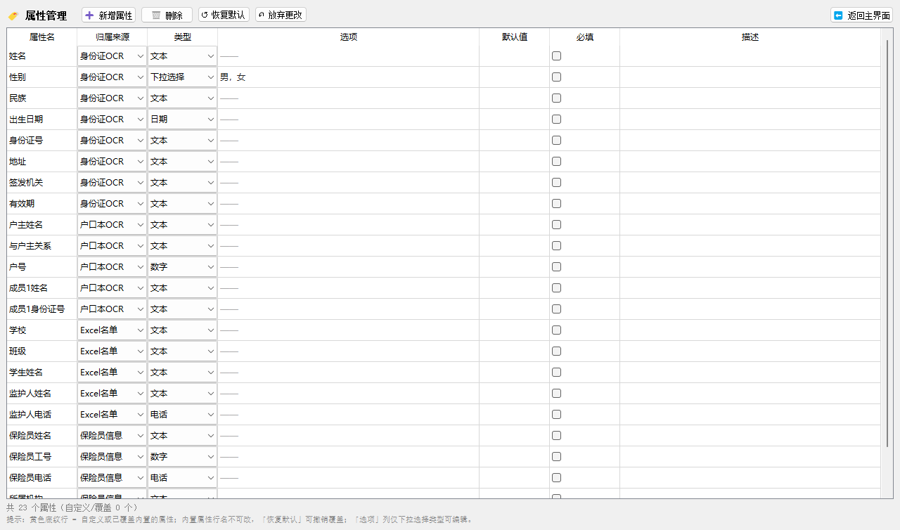
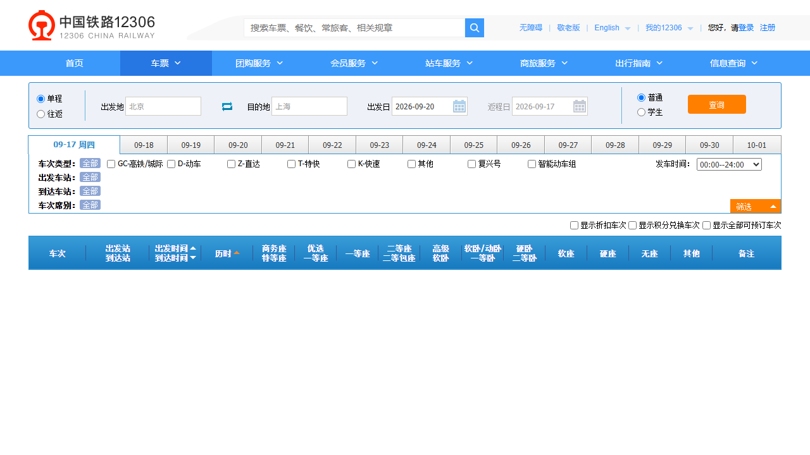
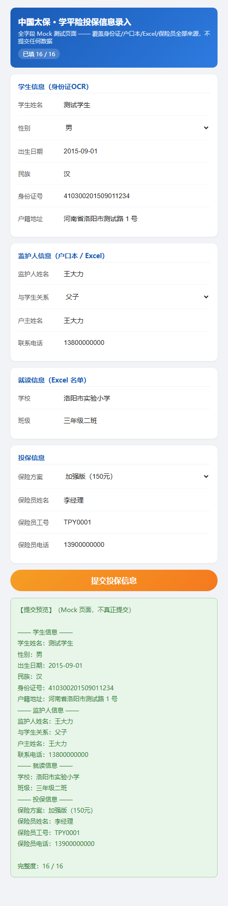
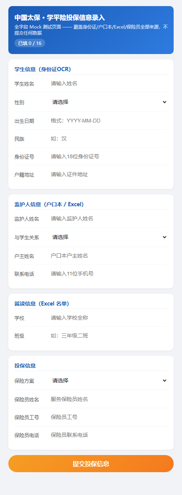

# FormPilot — 自动表单录入助手

> 用 AI 把自动化门槛降到零：拖入证件图 + 选择表单品种，自动完成网页表单填写。
>
> 针对**学平险 / 医保 / 体检表**等需要重复录入大量人员信息的场景设计。

---

## 项目简介

FormPilot 是一个本地桌面应用，通过三层模型降低自动化录入门槛：

1. **属性池**：全局可复用的属性（保险员信息 + 各类证件 OCR 结果 + 文件来源）
2. **品种**：每个录入场景一个「品种」配置，绑定「用哪些属性 + 填到页面哪里」
3. **AI 辅助定位**：首次创建品种时，AI 看页面问「这个框放哪个属性」，用户确认后永久保存

---

## 技术栈

| 类别 | 选型 |
|---|---|
| 语言 | Python 3.11+ |
| GUI | PyQt5 |
| OCR（主） | 腾讯云身份证 OCR API |
| OCR（备） | PaddleOCR |
| LLM | DeepSeek API |
| 浏览器自动化 | Playwright |
| 配置格式 | YAML |

---

## 目录结构

```
formpilot/
├── README.md
├── requirements.txt
├── main.py                       # 启动入口
├── config/                       # 全局配置
│   ├── settings.yaml
│   └── product_library/          # 保险品种库
│       ├── 太保洛阳学平险_基础.yaml
│       ├── 太保洛阳学平险_加强.yaml
│       └── _template.yaml
├── core/                         # 核心框架层
│   ├── property_source.py        # 属性来源抽象接口
│   ├── product.py                # 品种数据类
│   ├── property_pool.py          # 属性池管理器
│   └── registry.py               # 属性来源注册表
├── sources/                      # 属性来源实现（可扩展）
│   ├── global_user_info.py
│   ├── idcard_ocr.py
│   ├── household_ocr.py
│   └── excel_source.py
├── page/                         # 页面处理层
│   ├── scanner.py                # DOM 扫描器
│   ├── matcher.py                # LLM 字段匹配器
│   └── filler.py                 # 填表器
├── verifier/                     # 校验层
│   └── checker.py                # 回读校验
├── ocr/                          # OCR 工具层
│   ├── tencent_cloud.py
│   ├── paddle_ocr.py
│   └── llm_extractor.py
├── gui/                          # PyQt5 界面层
│   ├── main_window.py            # 主窗口（三段式布局）
│   ├── product_list_panel.py     # 左侧：品种列表
│   ├── property_panel.py         # 中间：属性面板
│   ├── page_panel.py             # 右下：页面预览与填表
│   └── widgets/
│       ├── source_group.py
│       └── property_field.py
├── tools/                        # 工具脚本
├── tests/                        # 测试
└── docs/                         # 文档
```

---

## 运行步骤

```bash
# 1. 安装依赖
pip install -r requirements.txt

# 2. 启动应用
python main.py
```

### 拖图测试（Phase 2）

当前已接入 OCR 识别链路，`mock_mode: true` 时**无需任何 API key 即可拖图测试**：

1. 启动 `python main.py`
2. 左侧选中一个品种（如「太保洛阳学平险_基础」）
3. 中间属性面板的「📌 身份证OCR」分组框内，直接**拖入任意图片**（jpg/png）
   —— 或点击分组底部的「📤 上传输入」选择文件
   （上传入口只在分组底部一处，属性行内没有按钮；手动配置型来源如
   「保险员信息」不显示上传入口）
4. 拖入后自动识别，字段即时回填（Mock 模式下为固定测试数据，状态栏会提示「Mock 数据」）
5. **分组框内随即显示证件缩略图，点击可查看大图** —— 对照原图人工核对
   识别结果是否有误
6. 依次拖入 Excel 文件、户口本图，完成各来源录入
7. 点「🚀 开始录入」，右下角显示填表报告

> 接入真实 OCR 时：编辑 `config/settings.yaml`，把 `mock_mode` 设为 `false`
> 并填入腾讯云 / DeepSeek 的密钥，OCR 引擎会自动切换到真实 API（失败仍回退 Mock）。
> 腾讯云侧需先安装 SDK（`pip install tencentcloud-sdk-python-ocr`）并在
> 控制台**开通文字识别服务**（有每月免费额度）；未开通时程序会回退 Mock
> 并在状态栏提示失败原因。
> Excel 来源的数据校验（表格预览/逐行核对）暂缓，待数据源形态确定后再做。

### LLM 调用模式：网页版全自动（默认，无需 API key）

`config/settings.yaml → llm.mode` 支持两种模式：

```yaml
llm:
  mode: web     # 网页版 DeepSeek：Playwright 驱动 chat.deepseek.com，全自动
  # mode: api   # 官方 API：需填写 llm.api_key
```

**网页版模式（web）** —— 用于向导的字段匹配、户口本字段提取等 LLM 环节，
程序自动完成「开浏览器 → 注入提示词 → 按 Enter 发送 → 等待回复稳定 → 读回复」，
**全程无需人工操作**（与参考项目 Video2Team 的半自动方案不同，它由用户按回车）：

1. 首次使用先登录一次：`python tools/deepseek_web_login.py`，在弹出的浏览器里扫码
2. 之后即可直接用：登录态持久化在 `.deepseek_profile/`（已加入 .gitignore）
3. 会话串行、浏览器常驻，多次调用复用同一浏览器
4. 可附图片（`chat(prompt, images=[...])`）走多模态；失败自动降级：
   网页版失败 → 有 api_key 则回退官方 API → 再失败则由调用方回退启发式匹配

> 网页版偶尔会遇到 DeepSeek 页面改版或风控弹窗；此时报错信息会说明原因，
> 临时可切到 `mode: api` 或让它回退启发式匹配，主流程不中断。

**户口本走多模态**：未安装本地 PaddleOCR（重依赖）时，「户口本OCR」来源会
自动把照片直接发给网页版 DeepSeek 读图提取字段（约 25 秒），无需额外配置；
安装了 PaddleOCR 则走「本地识别文本 → LLM 提取」的常规两步。两个都不可用时
回退模拟数据并在状态栏提示原因。

### 新建品种（Phase 3）

点击工具栏「+ 新建品种」（或左侧列表下方同名按钮），按向导逐步操作：

1. **命名** — 输入品种名称和描述
2. **选择属性** — 勾选该品种需要填写的属性（来自已注册来源）
3. **输入 URL** — 目标网页表单地址；**移动端 H5 勾选「移动端 / 微信 H5」**
   （否则桌面环境会被服务端拒绝）；微信扫码入口先用「📷 从二维码图片导入 URL」
4. **扫描字段** — DOM 扫描器列出页面所有输入框
   （定位优先 `name` → `id` → `placeholder`，同名用 `>> nth=N` 区分；
   等 SPA 渲染出输入框再收集，最多约 8 秒）
5. **确认映射** — 查看每个属性匹配到的 locator，可手动修正，然后保存

保存后新品种会写入 `config/product_library/`，并自动刷新左侧列表。

#### 真实页面实测：太保洛阳学平险（2026-09）

「太保洛阳学平险_基础」品种已按**真实页面**配置好（真实活动链接 + 实测 locator +
移动端上下文）：投保人/被保险人各 姓名/身份证/手机号/邮箱 共 8 个字段可定位，
方案卡片用 `fill_mode: click` 选择。限制说明：

- 链接来自微信二维码（`?mId=…&vCode=…`），换活动要重新导入二维码
- 该站点**有访问频率限制**：连续请求会超时，验证/演示请间隔进行
- 扫描与定位已实测通过；因限流，真实页的完整填表验证建议间隔后用
  `python tools/try_fill.py "太保洛阳学平险_基础"` 复测

#### 微信 H5 / 扫码入口：从二维码图片导入 URL

太保投保页这类「微信内打开」的 H5，**直接输网址会被提示
「活动不存在或已下线 ERR-2021」**——真正可用的链接带在二维码里
（含活动 ID / 机构代码等参数）。实测确认与 UA 无关（微信/移动/桌面 UA
都返回同样的错误页），**门槛是 URL 参数，不是微信环境**。

处理方式（无需自动化微信本身）：

1. 在微信里把那张二维码图片**保存成文件**（PC 端右键 → 另存为）
2. 向导第 3 步点「**📷 从二维码图片导入 URL**」→ 选择图片 → 自动填入真实链接
   （或命令行：`python tools/decode_qrcode.py <图片>` 打印 URL）
3. 继续第 4 步正常扫描/确认即可；扫描为空时页面也会提示这条路径

> 依赖：`pip install pyzbar pillow`（轻量）；未装 pyzbar 时尝试
> `opencv-python-headless`。中文内容的二维码解码可能受 zbar 字符集推断
> 影响，但链接（ASCII）不受影响——本项目只取链接。

### 开始录入（Phase 4）

1. 属性面板各来源已填好（拖图/选文件后自动回填，或手动编辑）
2. 点「🚀 开始录入」按钮
3. 右下角显示填表报告：逐字段填充结果 + 回读校验结果

- **Mock 模式**（`mock_mode: true`）：仅做「值可用性」检查，不真实打开浏览器
- **真实模式**（`mock_mode: false` 且已 `playwright install chromium`）：
  打开目标页面 → 逐字段填写 → 回读校验 → **保持浏览器打开，等用户核对后手动提交**

> 半自动合规设计：自动填表但**不自动点提交**，由用户在浏览器中人工确认后提交。

### 保险员信息持久化

「📌 保险员信息」是全局手动配置项：点「🚀 开始录入」时自动保存到
`config/global_user_info.yaml`（含个人信息，已加入 `.gitignore` 不入版本库），
下次启动选中品种后自动预填——配置一次，之后所有品种反复使用。

### 规则引擎（recommend_by_grade）

品种 yaml 中声明 `rule: recommend_by_grade` 的字段（如「保险方案」），
在属性池**没有该值**时由规则引擎自动推荐：

- 优先从「班级」解析年级（三年级二班 → 3），否则按「出生日期」推算
  （满 6 周岁入学，截止 8 月 31 日）
- 年级 → 档位：1~3 年级 → 基础版（100元）；4~6 年级 → 加强版（150元）；
  7 年级及以上 → 尊享版（200元）。映射表见 `core/rule_engine.py` 的
  `GRADE_PLAN_MAP`，对接不同页面时可改文案
- 规则只补空、不覆盖显式值；推荐结果回喂属性池并参与回读校验，
  填表报告中会标注「由规则 recommend_by_grade 推荐」

### 属性管理（创建属性）

属性不再是写死的字符串，而是**属性对象**（名称 / 归属来源 / 字段类型 /
选项 / 默认值 / 必填 / 描述），保存在 `config/property_library.yaml`：

1. 点工具栏「🏷️ 属性管理」——**主窗口内部切换到属性管理页**（不弹新窗口，
   按钮再次点击或点「⬅ 返回主界面」切回三栏工作区）
2. 所有操作按钮在表格上方：**➕ 新增属性 / 🗑 删除 / ↺ 恢复默认 /
   ↶ 放弃更改 / 💾 保存**
3. **直接在表格里编辑**（无独立表单）：归属来源、类型是下拉框；必填是复选框；
   「选项」列仅在下拉选择类型时可编辑，其余类型显示 `——`
4. 内置属性行的**属性名只读**（防止改名撞车），其余字段可改，保存后形成「覆盖」
   （黄色底纹行）；点「↺ 恢复默认」撤销覆盖；自定义属性可直接删除
5. 「+ 新建品种」向导第 2 步的属性列表即来自属性库（内置 + 自定义），
   页面上也有「🏷️ 管理属性…」按钮可现场创建后返回刷新

属性对象在录入面板的效果：**归属来源**决定分组位置；**下拉选择**类型渲染为
下拉框；**默认值**自动预填（如保险员信息配一次即可反复使用）。

### 在线验证页（验证定位功能）

想用**真实的国内网页**验证「DOM 扫描 → 字段匹配 → 自动填表」链路，推荐
**12306 余票查询**（无需登录、长期稳定、字段命名规范）：

1. 左侧选择品种 **在线验证_12306余票查询**
2. 中间「其他」分组填写 出发地 / 到达地 / 出发日期（如 洛阳 / 上海 / 2026-10-01）
3. 点「🚀 开始录入」→ 浏览器打开 12306，三个字段自动填好并回读校验零差异；
   **查询按钮不会自动点击**，由你人工核对后决定

> 出发地/到达地是**联想选择框**（站点代码存在隐藏字段里，只写可见文本页面会
> 校验报错），品种里已声明 `fill_mode: autocomplete`：程序会自动写值触发联想、
> 在候选列表中点选对应车站（如 洛阳→LYF、上海→SHH），与人工操作等价。
> 在线断言见 `python tests/test_online_12306.py`（网络不可用时自动跳过）。

想扫描任意网页的输入框（验证扫描器）：

```bash
python tools/scan_url.py https://kyfw.12306.cn/otn/leftTicket/init
```

> 注：太保真实投保页等纯 JS 应用在无头扫描下拿不到输入框（需要登录态/更长的
> 渲染等待），这属于已知的「真实链路」待增强项。

### 全字段 Mock 测试页（推荐联调用）

`tests/mock_form_full.html` 是一个覆盖**全部属性来源**的本地 Mock 页面
（16 个字段：身份证 / 户口本 / Excel / 保险员信息），配套品种
「学平险_Mock全字段」：

1. 左侧选择品种 **学平险_Mock全字段**
2. 中间各来源组拖图 / 选文件（Mock 模式下自动回填测试数据），或直接手输
3. 点「🚀 开始录入」→ 浏览器打开本地 Mock 页，自动填完 16 个字段
4. 页面顶部计数器显示「已填 16 / 16」，点「提交投保信息」可查看提交预览与格式提醒

另有基础版 `tests/mock_form.html`（6 字段，与真实页面字段一致），配套品种
「学平险_本地Mock测试」。重新生成 Mock 页演示截图：

```bash
python tools/shoot_mock_full.py   # 输出到 docs/screenshots/
```

---

## 演示截图

| 说明 | 截图 |
|---|---|
| 属性管理（主窗口内部页面，内联编辑） |  |
| 在线验证：12306 真实页自动填表 |  |
| 全字段 Mock 页（已填 16/16 + 提交预览） |  |
| 全字段 Mock 页（空白态） |  |
| 主窗口三段式布局 | TODO：截图放入 `docs/screenshots/main_window.png` |
| 填表报告 | TODO：截图放入 `docs/screenshots/fill_report.png` |

---

## 实施阶段

- **Phase 1（骨架）**：目录结构 + PyQt5 三段式布局 + 静态品种列表 + 属性面板切换 ✅
- **Phase 2（OCR 接入）**：身份证/户口本/Excel/全局信息源 + 拖图自动识别回填 ✅
- **Phase 3（品种创建器）**：创建向导 + DOM 扫描 + LLM 字段匹配 + 保存 yaml ✅
- **Phase 4（自动填表）**：Playwright 填表 + 回读校验 ✅
- **Phase 5（打磨）**：README 完善 + 截图 + 测试 + 简历定稿

---

## 运行测试

测试为**纯脚本设计**，不依赖测试框架；两种方式任选：

```bash
# 方式一：一键运行全部并输出统计（通过/跳过/失败 + 耗时）
python tests/run_all.py

# 方式二：pytest（51 个用例，装了 pytest 后直接用）
pytest tests/ -q
```

单文件运行（逐个文件调试时用）：

```bash
python tests/test_property_source.py
python tests/test_matcher.py
python tests/test_filler.py
python tests/test_phase2_ocr.py
python tests/test_phase3_wizard.py
python tests/test_phase4_filler.py
python tests/test_property_def.py    # 属性对象与属性库
python tests/test_rule_engine.py     # 规则引擎（年级→方案推荐）
python tests/test_web_llm.py         # 网页版 LLM（JSON 解析/容错修复/模式路由/降级链）
python tests/test_mock_full_page.py  # 端到端：Playwright 填全字段 Mock 页
python tests/test_online_12306.py    # 在线：12306 真实网页（联想选择框）
python tests/test_online_tencent_ocr.py  # 在线：腾讯云真实身份证识别
python tests/test_online_web_llm.py      # 在线：网页版 DeepSeek 真实全自动调用

# GUI 离屏烟雾测试（属性管理/向导/面板，不开窗口）
python tools/smoke_property_ui.py
```

> 在线与浏览器用例在无网络 / 未装 Playwright / 未配置密钥 / 服务未开通时
> 会**自动跳过**（pytest 下标记为 skipped；脚本下打印 `skip: 原因`），
> 不会误报失败。只想跑离线单元测试：`pytest tests/ -q -k "not online"`。
> 注意在线用例会消耗真实额度/耗时（腾讯云 1-2 次调用、网页版 DeepSeek 2 次问答）。